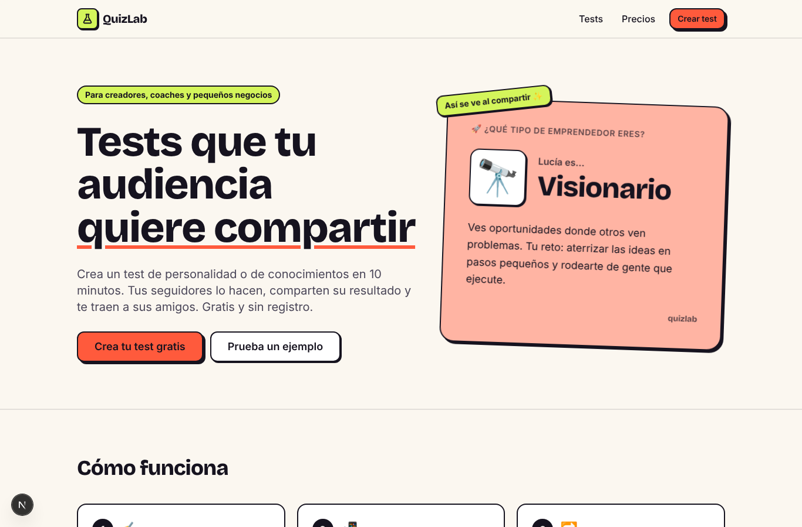
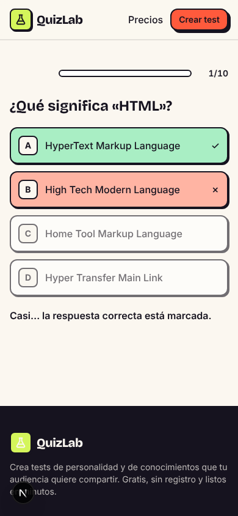
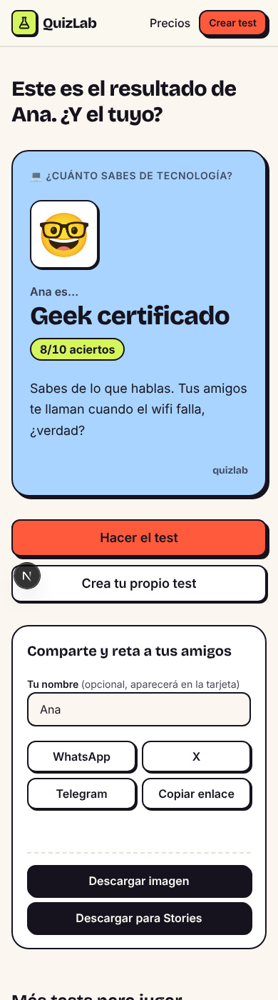
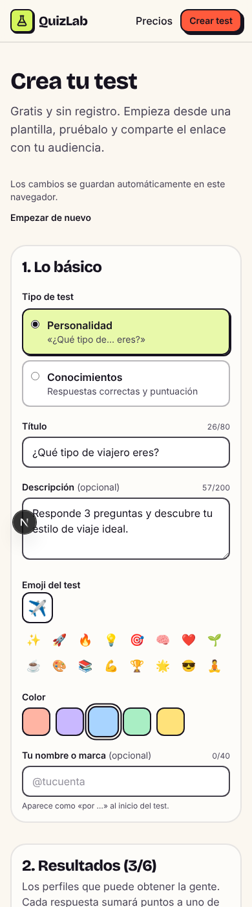
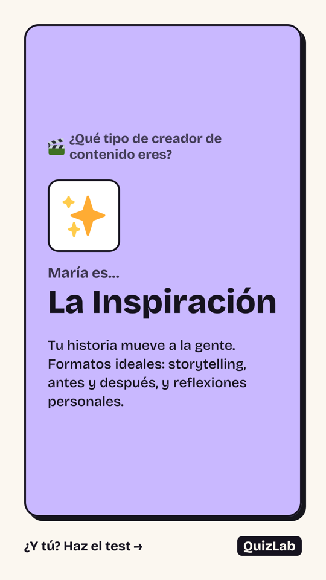

# QuizLab 🧪

**Tests virales para crecer tu audiencia.** Crea un test de personalidad o de conocimientos en minutos, compártelo con un enlace y deja que tu audiencia comparta su resultado (con una imagen lista para redes y Stories).

Público inicial: **creadores de contenido, coaches/formadores y pequeños negocios hispanohablantes**.

> Estado: **MVP funcional** (primera versión). Ver [PLAN.md](PLAN.md) para la estrategia y [TODO.md](TODO.md) para los siguientes pasos.



| Pregunta (móvil) | Resultado (móvil) | Editor (móvil) | Imagen para Stories |
| --- | --- | --- | --- |
|  |  |  |  |

---

## ¿Qué puede hacer ya?

| Función | Dónde |
| --- | --- |
| Landing que explica el producto | `/` |
| 4 tests de ejemplo jugables sin registro | `/t/emprendedor`, `/t/tecnologia`, `/t/creador-de-contenido`, `/t/cafe` |
| Tests de **personalidad** (cada respuesta suma a un perfil) y de **conocimientos** (aciertos) | — |
| Página de resultado compartible con vista previa en WhatsApp/X/Telegram | `/t/<test>/r/<resultado>` |
| Compartir: botón nativo del móvil, WhatsApp, X, Telegram y copiar enlace | página de resultado |
| Descargar la tarjeta del resultado en PNG (post 1200×630 y **Stories 1080×1920**) | `/api/card` |
| «Retar» a amigos: el nombre aparece en la tarjeta («Lucía es…») | página de resultado |
| **Editor de tests** con plantillas, validación en español, vista previa y publicación por enlace | `/crear` |
| Borrador autoguardado y lista de tests publicados (en el navegador) | `/crear` |
| Página de precios con prueba de interés del plan Pro (sin cobros) | `/precios` |
| Analítica sin cookies (Umami, opcional) y enlaces de feedback | ver `.env.example` |

**No necesita base de datos ni cuentas**: cada test creado se guarda comprimido dentro de su propio enlace. Coste de funcionamiento: 0 € para empezar.

---

## Arrancar el proyecto en tu ordenador (paso a paso)

### 1. Requisitos (solo la primera vez)

- **Node.js 20 o superior** (recomendado 22). Descárgalo de <https://nodejs.org> (versión «LTS»).
  Comprueba que está instalado abriendo una terminal y escribiendo:
  ```bash
  node -v   # debe mostrar v20.x o superior
  ```
- **Git** (<https://git-scm.com>) para descargar el código.

### 2. Descargar el código

El proyecto está en la rama `quizlab-mvp` de tu repositorio de GitHub:

```bash
git clone --branch quizlab-mvp https://github.com/cris13354/opencode.git quizlab
cd quizlab
```

> Esta rama solo contiene QuizLab (no tiene nada que ver con el resto del repositorio). Te recomiendo moverlo a un repositorio propio: ver «Mover a su propio repositorio» más abajo.

### 3. Instalar dependencias

```bash
npm install
```

### 4. Arrancar en modo desarrollo

```bash
npm run dev
```

Abre <http://localhost:3000> en el navegador. Los cambios que hagas en el código se ven al instante.

Para pararlo: `Ctrl + C` en la terminal.

### 5. (Opcional) Variables de entorno

Funciona sin configurar nada. Para activar analítica o formularios, copia el archivo de ejemplo y rellénalo:

```bash
cp .env.example .env.local
```

Cada variable está explicada dentro de `.env.example`.

---

## Comandos útiles

| Comando | Qué hace |
| --- | --- |
| `npm run dev` | Arranca la web en modo desarrollo (http://localhost:3000) |
| `npm run build` | Crea la versión optimizada para producción |
| `npm start` | Sirve la versión de producción (después de `build`) |
| `npm run lint` | Revisa el estilo y errores comunes del código (ESLint) |
| `npm run typecheck` | Comprueba los tipos de TypeScript |
| `npm test` | Pruebas unitarias (Vitest) — lógica de tests, puntuación, enlaces… |
| `npm run test:e2e` | Pruebas en un navegador real (Playwright): juega tests, crea uno, etc. |
| `npm run check` | `lint` + `typecheck` + `test` de una vez. Ejecútalo antes de subir cambios |

Para las pruebas en navegador, la primera vez instala Chromium: `npx playwright install chromium`.

---

## Desplegar gratis en Vercel

1. Crea una cuenta en <https://vercel.com> (puedes entrar con GitHub).
2. Pulsa **Add New → Project** e importa el repositorio. Si sigue en la rama `quizlab-mvp`, en *Settings → Git* elige esa rama como **Production Branch**.
3. Vercel detecta Next.js solo. No hace falta cambiar nada. Pulsa **Deploy**.
4. (Opcional) En *Settings → Environment Variables* añade las variables de `.env.example`.
5. Cada vez que hagas `git push`, Vercel publicará la nueva versión automáticamente.

**Importante sobre el plan gratuito de Vercel (Hobby):** sus condiciones lo limitan a **uso no comercial**. Para validar la idea está bien, pero cuando empieces a cobrar tendrás que pasar al plan Pro (~20 $/mes) o usar otra plataforma (Netlify o Cloudflare también tienen planes gratuitos; comprueba sus condiciones actuales).

### Mover a su propio repositorio (recomendado)

```bash
# 1. Crea un repositorio vacío en GitHub llamado "quizlab" (privado si quieres).
# 2. Desde la carpeta del proyecto:
git remote set-url origin https://github.com/<tu-usuario>/quizlab.git
git push -u origin quizlab-mvp:main
```

---

## Estructura del proyecto

```
src/
├── app/                      Páginas (cada carpeta = una URL)
│   ├── page.tsx              Landing  →  /
│   ├── crear/page.tsx        Editor   →  /crear
│   ├── precios/page.tsx      Precios  →  /precios
│   ├── privacidad/page.tsx   Privacidad
│   ├── t/[ref]/page.tsx      Jugar un test  →  /t/<test>
│   ├── t/[ref]/r/[result]/   Resultado compartible  →  /t/<test>/r/<n>
│   ├── api/card/route.tsx    Genera las imágenes PNG de las tarjetas
│   ├── layout.tsx            Estructura común (cabecera, pie, fuentes, analítica)
│   └── globals.css           Colores y estilos de la marca
├── components/
│   ├── quiz/                 Reproductor, tarjeta de resultado, compartir…
│   ├── editor/               Editor de tests y sus piezas
│   └── ui/                   Botones, contenedor, logo
├── lib/
│   ├── quiz/schema.ts        Modelo de datos de un test + validación (zod)
│   ├── quiz/codec.ts         Guardar un test dentro del enlace (comprimido)
│   ├── quiz/scoring.ts       Cálculo del resultado
│   ├── quiz/catalog.ts       Tests de ejemplo  ← edita aquí para añadir más
│   ├── quiz/templates.ts     Plantillas del editor
│   ├── quiz/editing.ts       Operaciones del editor (añadir/quitar preguntas…)
│   ├── quiz/drafts.ts        Borradores en el navegador (localStorage)
│   ├── quiz/resolve.ts       Buscar un test por su enlace y construir URLs
│   ├── analytics.ts          Medición de eventos (Umami, sin cookies)
│   └── site.ts               Configuración general (nombre, URLs)
└── assets/fonts/             Fuente de la marca para las imágenes PNG
e2e/                          Pruebas en navegador (Playwright)
```

Más detalles técnicos en [ARCHITECTURE.md](ARCHITECTURE.md).

### Tareas típicas

- **Añadir un test de ejemplo:** copia un bloque en `src/lib/quiz/catalog.ts`, cambia el `slug` y ejecuta `npm test` (comprueba que es válido y que todos los resultados son alcanzables).
- **Cambiar colores:** `src/app/globals.css` (bloque `@theme`) y `src/lib/quiz/colors.ts`.
- **Cambiar textos de la landing:** `src/app/page.tsx`.
- **Cambiar precios:** `src/app/precios/page.tsx`.

---

## Tecnología

- [Next.js 16](https://nextjs.org) (App Router, Cache Components) + React 19 + TypeScript
- [Tailwind CSS 4](https://tailwindcss.com) para los estilos
- [zod](https://zod.dev) para validar datos que llegan por URL
- `next/og` para generar las imágenes PNG
- Vitest (pruebas unitarias) y Playwright (pruebas en navegador)

## Créditos y licencias de terceros

- Emojis de las imágenes: [Twemoji](https://github.com/jdecked/twemoji) — gráficos bajo licencia **CC-BY 4.0** (la atribución aparece en el pie de la web).
- Fuente: Bricolage Grotesque e Inter — SIL Open Font License.
